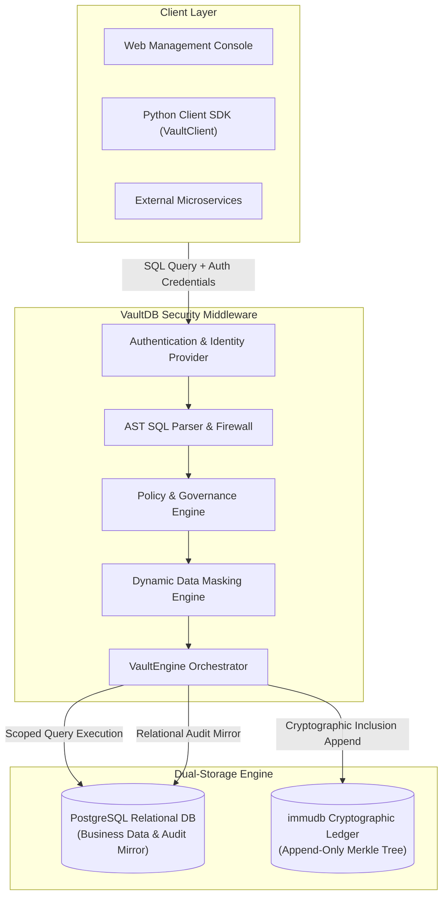
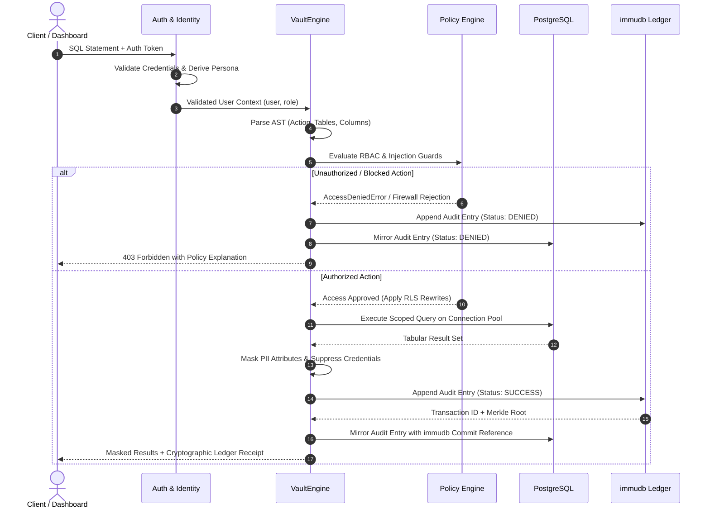
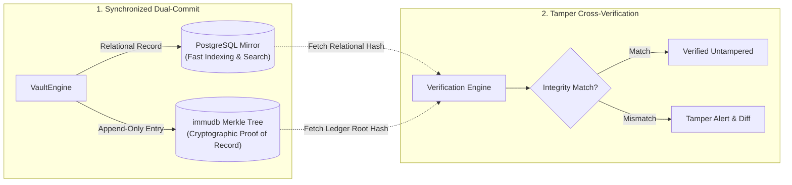
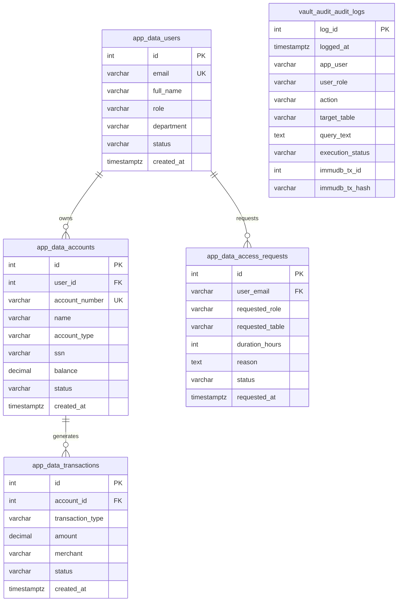

# VaultDB: System Architecture Document

## 1. Executive Summary & Design Goals

VaultDB is a zero-trust database middleware and compliance auditing platform designed to enforce strict access control, transparent query interception, and tamper-evident audit logging for relational databases.

Modern compliance frameworks (including GDPR, HIPAA, and PCI-DSS) require organizations to answer:
> *"Who accessed sensitive customer data, what exact operations did they execute, and can we prove the historical records have not been altered or deleted?"*

VaultDB addresses these requirements at the middleware and storage layers:
* **Zero Client Trust**: All user identities and operational permissions are resolved and enforced server-side.
* **Transparent Query Interception**: Every incoming SQL query is intercepted, parsed, and evaluated prior to execution against the underlying database.
* **Synchronized Dual-Commit**: Query results and audit events are committed simultaneously to both an indexable PostgreSQL relational store and an append-only cryptographic Merkle tree ledger (immudb).
* **Guaranteed Immutability**: Historical audit records cannot be modified or deleted, enforced by database-level triggers and mathematical Merkle root commitments.

---

## 2. High-Level System Architecture

VaultDB is organized into three primary layers: **Client Applications**, the **Security & Governance Middleware**, and the **Dual-Storage Engine**.

### Component Responsibilities

1. **Client Layer**:
   - **Web Management Console**: Interactive administrative and auditing interface for query execution, live ledger inspection, schema visualization, and certified report generation.
   - **Python Client SDK (`VaultClient`)**: Programmatic client library enabling microservices and automated workflows to interact with VaultDB via zero-trust API contracts.

2. **Security & Governance Middleware**:
   - **Authentication & Identity**: Derives authenticated user identity and assigned role server-side via cryptographic tokens (JWT) or API keys.
   - **AST SQL Parser & Firewall**: Deconstructs raw SQL statements into structured Abstract Syntax Trees (AST) using SQLGlot to extract targets, statement actions, and protect against multi-statement injections.
   - **Policy & Governance Engine**: Enforces matrix-based Role-Based Access Control (RBAC) and applies dynamic Row-Level Security (RLS) query rewriting.
   - **Dynamic Data Masking Engine**: Redacts sensitive Personally Identifiable Information (PII) such as Social Security Numbers, credit cards, and credential fields before delivering results to unauthorized personas.
   - **VaultEngine Orchestrator**: Manages execution against PostgreSQL connection pools and dispatches dual-commit transactions.

3. **Dual-Storage Engine**:
   - **PostgreSQL**: Stores relational business tables (`users`, `accounts`, `transactions`, `access_requests`) and an indexable audit trail mirror (`vault_audit.audit_logs`).
   - **immudb**: An append-only cryptographic ledger maintaining SHA-256 Merkle trees for mathematical tamper-evidence and cryptographic verification.

---

## 3. Query Interception & Logging Architecture

The core operational principle of VaultDB is deterministic query interception. No client application communicates with the relational database directly.

### Audit Log Schema & Payload

For every query received, VaultDB extracts and records the complete operational context:

| Field | Description | Example |
| :--- | :--- | :--- |
| `log_id` | Unique sequential log identifier | `1042` |
| `logged_at` | Server-authoritative timestamp | `2026-10-22 10:30:45 UTC` |
| `app_user` | Authenticated application user | `sarah@company.com` |
| `user_role` | Active security persona | `writer` |
| `action` | Parsed SQL action | `SELECT`, `INSERT`, `UPDATE`, `DELETE` |
| `target_table` | Target relational relation | `customers` |
| `query_text` | Sanitized SQL query text | `SELECT email FROM customers WHERE id = 123` |
| `execution_status`| Terminal execution outcome | `SUCCESS`, `DENIED`, `ERROR` |
| `immudb_tx_id` | Ledger transaction sequence height | `582` |
| `immudb_tx_hash` | Cryptographic Merkle state root | `e3b0c44298fc1c149afbf4c8996fb92427ae41e4649b934ca495991b7852b855` |

---

## 4. Access Control Architecture

VaultDB enforces a multi-tier governance model combining Role-Based Access Control (RBAC) with Row-Level Security (RLS).

### 4.1 Role-Based Access Control (RBAC)

Access permissions are decoupled from application logic and maintained in an immutable server-side matrix.

| Persona | Permitted SQL Actions | Table Scope | Sensitivity Clearance |
| :--- | :--- | :--- | :--- |
| **admin** | `SELECT`, `INSERT`, `UPDATE`, `DELETE` | All business relations | Unrestricted |
| **employee / writer** | `SELECT`, `INSERT`, `UPDATE` | Operational tables (`accounts`, `transactions`) | Masked PII |
| **auditor / reader** | `SELECT` | All relations + Audit trail | Read-only, Masked PII |
| **customer** | `SELECT` (strictly RLS-scoped) | Personal records only | Masked PII, Self-Only |

*Note: DDL statements (`DROP`, `ALTER`, `TRUNCATE`) and administrative privilege escalation commands (`SET ROLE`, `GRANT`) are blocked across all non-admin execution paths by the AST firewall.*

### 4.2 Row-Level Security (RLS) Dynamic Query Rewriting

When a customer or tenant executes a query, VaultDB's AST rewriter dynamically intercepts the query tree before database dispatch:
1. Detects customer ownership scope from the server-derived identity (`user_id` or `account_number`).
2. Synthesizes an AST predicate constraint (e.g., `WHERE user_id = :authenticated_user_id`).
3. Injects the constraint into the query AST and serializes the rewritten SQL string.
4. If a client attempts to query foreign records (e.g., specifying another tenant's account number), the rewriter flags a cross-tenant violation, aborts execution, and records an anomaly.

---

## 5. Immutable Audit Storage Strategy

To satisfy strict regulatory audit criteria, VaultDB enforces immutability at two independent layers: the relational engine level and the cryptographic ledger level.

### Layer 1: PostgreSQL Engine-Level Triggers
Within PostgreSQL, the audit trail table `vault_audit.audit_logs` is protected by PL/pgSQL database triggers:
* **Mutation Rejection**: Any direct `UPDATE`, `DELETE`, or `TRUNCATE` query executed against `vault_audit.audit_logs` (even by database users with write privileges) raises an immediate procedural exception (`RAISE EXCEPTION`) and rolls back the transaction.
* **Server Time Enforcement**: Timestamps default to `CURRENT_TIMESTAMP`, preventing backdating or client-side timestamp manipulation.

### Layer 2: immudb Cryptographic Merkle Ledger
In addition to relational persistence, each audit event is committed to immudb:
* **Append-Only Merkle Tree**: Every write operation advances the ledger height and computes a SHA-256 state root encompassing all historical transactions.
* **Cryptographic Inclusion Proofs**: When an auditor requests proof of a transaction, immudb provides a mathematical proof path connecting the specific audit record to the committed Merkle root.
* **Tamper-Evident Verification**: If an out-of-band actor (such as a database administrator) modifies records directly in PostgreSQL, the cross-verification engine flags the divergence by comparing the relational copy against the cryptographic immudb root truth.

---

## 6. Data Storage & Relational Schema Design

VaultDB partitions relational data into two distinct PostgreSQL schemas to enforce separation of concerns: `app_data` (business tables) and `vault_audit` (compliance logs).

---

## 7. Sensitive Query Detection & Dynamic Masking

VaultDB detects sensitive queries during AST inspection and ensures sensitive data is protected both in transit and in stored compliance trails.

### Sensitive Column Detection
During the AST traversal, the parser extracts referenced table attributes. If any column matches sensitive patterns (such as `ssn`, `password`, `credit_card`, `secret`, `cvv`), the query is flagged as sensitive:
* The sensitive status is displayed prominently in the audit dashboard.
* The query is tracked for statistical reporting and compliance aggregation.

### In-Flight Dynamic Masking
Before query results leave the middleware:
1. **PII Masking**: Values in sensitive fields (e.g., SSN) are masked for non-administrative roles (e.g., `***-**-1234`).
2. **Credential Suppression**: High-security fields (such as `password_hash` and `api_key`) are stripped from tabular results and schema introspection responses across all standard roles.
3. **Audit Text Sanitization**: Literal credential constants within the SQL statement string are redacted prior to committing the text to persistent audit logs.

---

## 8. Failure Semantics & Security Guarantees

VaultDB is designed around defense-in-depth principles:

1. **Guaranteed Audit Trail (Fail-Closed)**:
   - Audit logging occurs within a strictly enforced `try ... finally` execution block.
   - If an unexpected error, query syntax fault, or database failure occurs during query processing, the failure event is recorded in the audit trail before the error response is returned to the client.

2. **Zero In-Memory Leakage**:
   - Client applications receive data strictly after masking transformations have executed.
   - Raw database connection handles are maintained within the middleware connection pool and never exposed to client callers.

3. **Multi-Statement Injection Prevention**:
   - The AST firewall rejects stacked SQL queries (e.g., `SELECT 1; DROP TABLE users;`) by enforcing single-statement AST validity per execution request.

4. **Tamper Isolation**:
   - The cryptographic ledger runs as an independent process with separate storage and credentials from the relational database, preventing single-point compromises.
