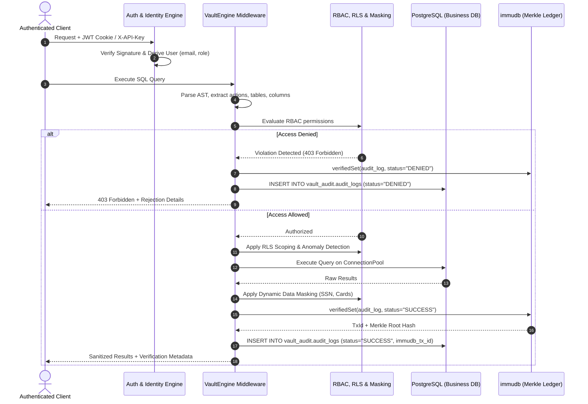

# VaultDB System Architecture

> **Cryptographically Immutable Database Middleware with PostgreSQL & immudb**

VaultDB is an enterprise-grade compliance and database security middleware layer designed to provide **server-derived authentication**, **zero-trust role-based access control (RBAC)**, **row-level security (RLS)**, **dynamic data masking**, and **cryptographically verifiable audit logging** (satisfying GDPR Art. 30, HIPAA §164.312, and PCI-DSS 10.2).

---

## 1. Problem Statement & Defense-in-Depth Strategy

### The Single-Store Relational Auditing Flaw
In conventional relational databases (such as standalone PostgreSQL), audit records stored in standard SQL tables remain vulnerable to internal and external threats:
1. **Rogue DBA / Superuser Modifications**: A user possessing `postgres` superuser privileges can execute `ALTER TABLE ... DISABLE TRIGGER ALL`, update historical audit records, delete rows, or truncate the audit table.
2. **Absence of Cryptographic Verification**: Relational rows do not produce cryptographic inclusion proofs. An external auditor cannot verify whether a log was altered after the fact.
3. **Client-Claimed Identity Flaws**: Systems that accept user identity or roles directly from client HTTP payloads are subject to trivial identity spoofing.

### VaultDB Dual-Storage Architecture
VaultDB solves this by coupling two complementary storage engines under a unified middleware:

```
+---------------------------------------------------------------------------------------------------+
|                                        Client Applications                                        |
|              (Web Management Console, Python SDK, Microservices, Automated Test Suites)           |
+-------------------------------------------------+-------------------------------------------------+
                                                  |
                                                  v
+---------------------------------------------------------------------------------------------------+
|                                         VaultDB Middleware                                        |
|                                                                                                   |
|  [Authentication & Identity]                                                                      |
|    - Salted PBKDF2-HMAC-SHA256 Password Verification                                              |
|    - RFC 7519 Compliant HS256 JWT (HttpOnly Cookie / Bearer Token)                                |
|    - Cryptographic API Key Verification (X-API-Key Header)                                        |
|    - Server-Derived Identity (Zero Client-Side Trust)                                             |
|                                                                                                   |
|  [SQL Security & Parser Engine]                                                                   |
|    - Action Extraction (SELECT, INSERT, UPDATE, DELETE, DDL:DROP, ALTER, TRUNCATE)                |
|    - Multi-Statement & CTE Write Inspection                                                       |
|    - Table & Schema Scope Extractor (Empty-Table Defense)                                         |
|    - Sensitive Column Detector                                                                    |
|                                                                                                   |
|  [Policy & Enforcement Layer]                                                                     |
|    - Role-Based Access Control (Admin, Auditor, Employee, Customer)                               |
|    - Dynamic Data Masking (SSN: ***-**-XXXX, Card Numbers, CVVs)                                  |
|    - Row-Level Security (RLS Query Rewriting Scoping Customer to Personal Rows)                   |
|    - Real-Time Anomaly Detector (Bulk Records >= 1000, Off-Hours Access, Unprivileged PII)        |
|                                                                                                   |
|  [Dual-Storage Audit Orchestrator]                                                                |
|    - Pre-execution attempt logging                                                                |
|    - Synchronized dual-commit (PostgreSQL Relational Mirror + immudb Merkle Tree)                 |
|    - Cross-Verification Engine (Merkle Root Consistency & Field-Level Diff Tracking)               |
+----------------------------------+------------------------------------+---------------------------+
                                   |                                    |
                                   v                                    v
+---------------------------------------------------+  +--------------------------------------------+
|             PostgreSQL Relational Store           |  |          immudb Cryptographic Ledger       |
|                                                   |  |                                            |
| - ConnectionPool (psycopg-pool)                   |  | - Append-Only Merkle Tree Ledger           |
| - Business Data:                                  |  | - Cryptographic verifiedSet / verifiedGet  |
|     app_data.users                                |  | - Zero-Trust Inclusion Proofs              |
|     app_data.accounts                             |  | - SHA-256 State Root Commitments           |
|     app_data.transactions                         |  | - Immutable Audit Trail History            |
|     app_data.compliance_policies                  |  |                                            |
| - Relational Audit Mirror:                        |  |                                            |
|     vault_audit.audit_logs                        |  |                                            |
| - Immutability Triggers:                          |  |                                            |
|     Blocks UPDATE, DELETE, TRUNCATE at DB engine  |  |                                            |
+---------------------------------------------------+  +--------------------------------------------+
```

1. **PostgreSQL Relational Mirror**:
   - Stores fast, indexable relational audit logs in `vault_audit.audit_logs`.
   - Protected by database-level triggers (`trg_no_update_delete_audit`, `trg_no_truncate_audit`) that reject any attempt to modify or delete logs.
2. **immudb Cryptographic Append-Only Ledger**:
   - Commits each audit log key-value entry (`audit:log:{log_id}`) into an append-only cryptographic Merkle tree.
   - Computes linear transaction heights and state root hashes.
   - Provides cryptographic inclusion proofs (`verifiedSet`, `verifiedGet`).
3. **Dual-Store Cross-Verification**:
   - When an audit record is verified, the middleware fetches the record from both PostgreSQL and immudb, verifying that all fields (actor, role, action, target table, query text, execution status) match the immudb Merkle root exactly.
   - If a rogue DBA bypasses PostgreSQL triggers to alter an audit row, the discrepancy is immediately detected, showing the exact mutated fields alongside the immudb root truth.

---

## 2. Query Execution & Auditing Lifecycle



---

## 3. Core Engine Components

### 3.1 Authentication & Identity Layer
- **Salted PBKDF2-HMAC-SHA256**: Passwords stored in `app_data.users` use 100,000 iterations of SHA-256 with a unique 16-byte cryptographic salt.
- **RFC 7519 HS256 JWT**: Access tokens contain standard `sub`, `email`, `role`, and `exp` claims signed using a server-side secret key. Delivered via HttpOnly cookies (`vault_session`) or Bearer authorization headers.
- **Cryptographic API Keys**: Microservices and batch workers authenticate via `X-API-Key: vlt_key_...` headers checked against indexed hashes.
- **Dependency Injection**: The FastAPI route layer uses `get_current_user`, guaranteeing that requests cannot override identity via body parameters.

### 3.2 SQL Security & Parser Engine
- **Command Extraction**: Parses statements into categorized actions (`SELECT`, `INSERT`, `UPDATE`, `DELETE`, `DDL:DROP`, `ALTER`, `TRUNCATE`).
- **Scope & Table Extraction**: Identifies target tables across main clauses, JOINs, subqueries, and common table expressions (CTEs).
- **Empty-Table Defense**: Non-SELECT queries lacking explicit table declarations (e.g., `ALTER USER`, `SET ROLE`, `CREATE FUNCTION`) are caught and restricted to administrative privileges.
- **Sensitive Column Detection**: Identifies fields containing PII (`ssn`, `credit_card`, `card_number`, `cvv`) to trigger dynamic masking rules.

### 3.3 Access Control & Policy Engines
- **Role-Based Access Control (RBAC)**: Enforces table-level and statement-level authorization rules:
  - `Admin`: Full read, write, DDL, and administrative privileges.
  - `Auditor`: Read-only access to audit logs and compliance policy tables.
  - `Employee`: Operational read/write on transaction records; read-only on account tables; prohibited from balance modifications.
  - `Customer`: Strictly read-only access to own accounts and transactions.
- **Row-Level Security (RLS)**: Intercepts queries from customer roles and rewrites WHERE clauses to guarantee data isolation (e.g., constraining queries to `name = 'Alice Smith'`).
- **Dynamic Data Masking**: Replaces sensitive digits with masked patterns (e.g., `***-**-1234` for SSNs, `****-****-****-1234` for card numbers) in results returned to non-privileged roles.
- **Anomaly Detection**: Evaluates query execution characteristics against heuristic thresholds:
  - Bulk Row Volume: Flagged if returned record count >= 1,000.
  - Off-Hours Operations: Flagged if queries are run between 23:00 and 05:00 UTC.
  - Unprivileged PII Access: Flagged if customer or employee accounts query unmasked sensitive fields.

---

## 4. Role-Based Access Control (RBAC) Matrix

| Resource / Action | Customer | Employee | Auditor | Admin |
| :--- | :---: | :---: | :---: | :---: |
| `accounts:SELECT` | Allowed (RLS Scoped + Masked) | Allowed | Allowed | Allowed (Unmasked) |
| `accounts:INSERT/UPDATE/DELETE` | Denied | Denied | Denied | Allowed |
| `transactions:SELECT` | Allowed (RLS Scoped) | Allowed | Allowed | Allowed |
| `transactions:INSERT/UPDATE` | Denied | Allowed | Denied | Allowed |
| `transactions:DELETE` | Denied | Denied | Denied | Allowed |
| `users:SELECT` | Denied | Denied | Allowed | Allowed |
| `users:INSERT/UPDATE/DELETE` | Denied | Denied | Denied | Allowed |
| `audit_logs:SELECT` | Denied | Denied | Allowed | Allowed |
| `audit_logs:UPDATE/DELETE/TRUNCATE` | Denied (Trigger Enforced) | Denied (Trigger Enforced) | Denied (Trigger Enforced) | Denied (Trigger Enforced) |
| `DDL (DROP, ALTER, TRUNCATE)` | Denied | Denied | Denied | Allowed |

---

## 5. Viva & Architectural Defense Q&A

### Q1: Why not rely exclusively on PostgreSQL permissions and triggers for audit logging?
**Answer:** Relational databases are mutable by design. Any user with database administrator (`postgres` superuser) credentials can:
1. Temporarily disable triggers using `ALTER TABLE vault_audit.audit_logs DISABLE TRIGGER ALL;`.
2. Alter, backdate, or delete audit entries using standard SQL.
3. Re-enable triggers without leaving a relational trace in the audit table.
By maintaining an independent append-only Merkle tree ledger in immudb, VaultDB creates a separate cryptographic root of truth. Any out-of-band alteration in PostgreSQL causes an instant hash mismatch during cross-verification.

### Q2: What is the cryptographic mechanism behind immudb inclusion proofs?
**Answer:** When an audit log is written, immudb commits the key-value pair and calculates a cryptographic digest (SHA-256) within an append-only Merkle tree. Every state transition advances the ledger's linear transaction height and updates the tree root hash. When queried via `verifiedGet`, immudb provides a Merkle membership proof (the path of sibling hashes up to the certified root). If any transaction is modified or deleted, the Merkle root changes, mathematically invalidating the proof.

### Q3: How does VaultDB enforce zero-trust identity?
**Answer:** VaultDB derives the user identity strictly server-side. Passwords are verified against salted PBKDF2-HMAC-SHA256 hashes. Upon successful authentication, the server issues an RFC 7519 compliant HS256 JWT stored in an HttpOnly cookie (or API key). In the FastAPI middleware, the `get_current_user` dependency parses and cryptographically validates the token on every request. Client payloads cannot specify or override the `app_user` or `user_role` fields.

### Q4: How is high throughput maintained under concurrent load?
**Answer:**
1. **Connection Pooling**: PostgreSQL connections are managed via `psycopg_pool.ConnectionPool` (`POSTGRES_POOL_MIN=2`, `POSTGRES_POOL_MAX=10`), eliminating TCP handshake latency for incoming queries.
2. **Asynchronous Non-Blocking Web API**: Built on FastAPI and Uvicorn, serving concurrent asynchronous requests.
3. **Optimized Indexes**: Composite indexes on `vault_audit.audit_logs(logged_at, app_user, immudb_tx_id)` and business tables ensure sub-millisecond query evaluation.
