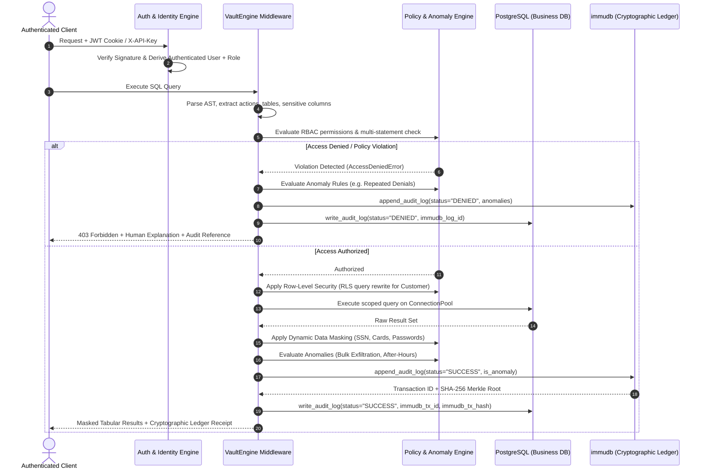

# VaultDB

### Zero-Trust Database Security Middleware & Cryptographic Audit Ledger

> **Mathematically prove who accessed your data, enforce zero-trust access policies, and eliminate database audit tampering.**

[](https://www.postgresql.org/)
[](https://immudb.io/)
[](https://fastapi.tiangolo.com/)
[](tests/)
[](#11-regulatory-compliance-mapping)
[](LICENSE)

---

## 1. Overview & Problem Space

In regulated enterprise environments (financial services, healthcare, fintech), proving **who accessed what data, when, and under what authority** is both an operational necessity and a strict legal requirement.

Traditional database architectures suffer from three critical security vulnerabilities:

1. **Mutable Audit Trails**: Anyone with database administrator (`postgres` superuser or DBA) privileges can modify, backdate, or truncate standard SQL audit tables (`DELETE FROM audit_logs`), eliminating forensic evidence of insider breaches.
2. **Client-Side Identity Spoofing**: Traditional query middleware often trusts the client application to declare its username or role in the payload, allowing attackers to impersonate higher-privileged actors.
3. **Reconnaissance Blind Spots**: Denied access attempts, cross-tenant probing, and multi-statement SQL injection attacks are frequently discarded without generating cryptographic audit records.

**VaultDB** solves these challenges by acting as a transparent, high-performance security proxy between client applications and relational storage. Every query is parsed, authorized under server-derived identity, sanitized against SQL injection, scoped to tenant boundaries, masked for sensitive PII, and permanently sealed into an immutable **immudb** cryptographic Merkle tree ledger.

```
+-------------------+      SQL Query + JWT / API Key      +----------------------+
|    Application    | ----------------------------------> |       VaultDB        |
|      Clients      | <---------------------------------- |      Middleware      |
+-------------------+    Masked Results + Ledger Receipt  +----------------------+
                                                              |              |
                                               Relational DB  |              | Cryptographic Ledger
                                                              v              v
                                                       +------------+  +------------+
                                                       | PostgreSQL |  |   immudb   |
                                                       +------------+  +------------+
```

---

## 2. Core Product Capabilities

### 🔒 Immutable Cryptographic Audit Ledger
* **Dual-Storage Synchronized Pipeline**: Every query attempt (both successful executions and rejected violations) is simultaneously recorded into a PostgreSQL relational mirror and committed to an append-only **immudb** Merkle tree.
* **Mathematical Inclusion Proofs**: Each audit entry produces a verifiable SHA-256 state root and linear transaction height. Auditors can independently verify cryptographic membership proofs directly in the web console or via API.
* **Engine-Level Immutability**: PostgreSQL PL/pgSQL triggers reject direct `UPDATE`, `DELETE`, and `TRUNCATE` operations on `vault_audit.audit_logs`. If a DBA circumvents relational triggers out-of-band, the Merkle tree state in immudb flags the discrepancy with field-by-field verification diffs.

### 🛡️ Role-Based Access Control (RBAC) & AST Parser
* **Server-Derived Identity**: Client requests cannot dictate or override `app_user` or `user_role`. Identity is derived strictly server-side from salted PBKDF2 password hashes, RFC 7519 HS256 JWT tokens, or cryptographically verified API keys.
* **AST-Level SQL Inspection**: Deep parsing extracts targets, actions (`SELECT`, `INSERT`, `UPDATE`, `DELETE`, `DDL:DROP`, `ALTER`), and sensitive attributes before execution.
* **Injection Firewall**: Blocks stacked queries (multi-statement injection), CTE write attacks (`WITH x AS (DELETE ...) SELECT 1;`), `COPY PROGRAM`, and unprivileged privilege escalation (`SET ROLE`).

### 👥 Tenant Isolation via Row-Level Security (RLS)
* **Automatic Query Rewriting**: Customer queries are dynamically intercepted and constrained to personal account and transaction records at runtime.
* **Cross-Tenant Violation Guard**: Explicit customer attempts to query foreign account numbers (`ACC-...`) or arbitrary user records are blocked with an immediate security denial and recorded into the ledger.

### 🎭 Dynamic In-Flight Data Masking
* **In-Flight PII Redaction**: Automatically redacts sensitive identifiers (Social Security Numbers as `***-**-XXXX`, credit card numbers, CVVs, and passwords) in query responses.
* **Masked Audit Trails**: Constants in SQL text are sanitized in both execution results and persistent audit logs, preventing PII leakage into compliance archives.

### ⚡ Behavioral Anomaly Detection Engine
* **Unusual Bulk Data Access**: Flags non-admin queries attempting to retrieve large row counts (`>= 1,000` rows) exceeding baseline operational thresholds.
* **Unusual After-Hours Access**: Flags employee or staff queries accessing sensitive customer financial records outside configured banking hours (`09:00 – 18:00 IST`). Customers accessing personal accounts 24/7 are exempt.
* **Repeated Unauthorized Access**: Accumulates failed access attempts in a sliding time window (`>= 2` denials within 5 minutes) and updates cumulative violation tracking with cross-references to the audit ledger.
* **Unusual Bulk Modification**: Flags high-impact `UPDATE` or `DELETE` statements affecting broad row sets (`>= 10` rows) without narrow primary key constraints.
* **Slack Webhook Dispatcher**: Dispatches real-time Slack Block Kit alerts when critical anomalies are detected.

### ⏳ Just-in-Time (JIT) Temporary Privilege Elevation
* **Self-Service Requests**: Employees and auditors can request temporary elevation (e.g. 1h, 12h, 24h) with mandatory business justifications.
* **Administrative Governance**: Administrators review, approve, reject, or immediately revoke active grants with one click.
* **Automated Expiration**: Active grants automatically expire after the granted window, reverting the user to baseline privileges.

### 📄 Audit-Grade Compliance PDF Reports
* **Filtered Audit Exports**: Compliance officers can generate certified PDF reports filtered by time range (24h, 7d, 30d, all time), user identity, role, and execution status.
* **Cryptographic Evidence**: Reports include cryptographic state roots, transaction IDs, client IPs, execution durations, and tamper verification status suitable for regulatory audits.

---

## 3. System Architecture & Lifecycle

```
+---------------------------------------------------------------------------------------------------+
|                                        Client Applications                                        |
|              (Web Management Console, Python SDK, Microservices, Automated Test Suites)           |
+-------------------------------------------------+-------------------------------------------------+
                                                  |
                                                  v
+---------------------------------------------------------------------------------------------------+
|                                         VaultDB Middleware                                        |
|                                                                                                   |
|  [Authentication & Server-Derived Identity]                                                       |
|    - Salted PBKDF2-HMAC-SHA256 Password Verification                                              |
|    - RFC 7519 Compliant HS256 JWT (HttpOnly Cookie / Bearer Token)                                |
|    - Cryptographic API Key Verification (X-API-Key Header)                                        |
|    - Zero Client Trust: User and Role are resolved strictly server-side                          |
|                                                                                                   |
|  [SQL Security & AST Parser Engine]                                                               |
|    - Action Extraction (SELECT, INSERT, UPDATE, DELETE, DDL:DROP, ALTER, TRUNCATE)                |
|    - Stacked Query & Multi-Statement SQL Injection Check                                          |
|    - Table & Schema Resolution with Real-Relation Validation                                      |
|    - Sensitive Column & PII Attribute Detection                                                   |
|                                                                                                   |
|  [Policy, Isolation & Enforcement Layer]                                                          |
|    - Role-Based Access Control (RBAC) across 4 Enterprise Personas                                |
|    - Row-Level Security (RLS) Query Rewriter (Personal Record Scoping)                            |
|    - Dynamic Data Masking Engine (Redacts SSN, Cards, Passwords in Results & Logs)                |
|    - Real-Time Behavioral Anomaly Detector (Bulk Rows, After-Hours Access, Repeated Denials)      |
|                                                                                                   |
|  [Dual-Storage Cryptographic Ledger Orchestrator]                                                 |
|    - Synchronous in-memory & disk buffering to eliminate UI race conditions                       |
|    - Synchronized dual-commit (PostgreSQL Relational Mirror + immudb Merkle Tree)                 |
|    - Cross-Verification Engine (Calculates Merkle Root Consistency & Field-Level Diff Tracking)   |
+----------------------------------+------------------------------------+---------------------------+
                                   |                                    |
                                   v                                    v
+---------------------------------------------------+  +--------------------------------------------+
|             PostgreSQL Relational Store           |  |          immudb Cryptographic Ledger       |
|                                                   |  |                                            |
| - ConnectionPool (psycopg-pool)                   |  | - Append-Only Merkle Tree Ledger           |
| - Business Data:                                  |  | - Cryptographic verifiedSet / verifiedGet  |
|     app_data.users                                |  | - Cryptographic Inclusion Proofs           |
|     app_data.accounts                             |  | - SHA-256 State Root Commitments           |
|     app_data.transactions                         |  | - Linear Transaction Heights               |
|     app_data.access_requests                      |  | - Zero External Mutation Capability        |
| - Relational Audit Mirror:                        |  |                                            |
|     vault_audit.audit_logs                        |  |                                            |
| - Engine-Level Immutability Triggers:             |  |                                            |
|     Rejects UPDATE, DELETE, TRUNCATE via PL/pgSQL |  |                                            |
+---------------------------------------------------+  +--------------------------------------------+
```

### Query Execution Sequence



---

## 4. Threat Model & Security Defenses

| Threat Vector | Attack Scenario | VaultDB Defense Mechanism |
| :--- | :--- | :--- |
| **Rogue DBA / Insider Threat** | Attacker with database admin access executes `DELETE FROM audit_logs` or modifies past queries. | **immudb Merkle Tree**: Immutable append-only ledger prevents alterations. PostgreSQL triggers reject direct table mutations. In-browser verification flags field-by-field diffs if the relational store is tampered with. |
| **Client Identity Spoofing** | Adversary injects `{"user": "admin@bank.com"}` in query parameters. | **Server-Derived Identity**: User identity and permissions are resolved exclusively from cryptographic JWT signatures or API keys. Client declarations are ignored. |
| **Stacked SQL Injection** | Malicious input attempts `SELECT 1; DROP TABLE app_data.accounts;`. | **AST Multi-Statement Firewall**: Detects stacked statements and CTE write vectors; blocks execution before reaching PostgreSQL and logs a security violation. |
| **PII Data Exfiltration** | Employee attempts to query unmasked customer SSNs or card numbers. | **Dynamic Data Masking**: In-flight regex masking redacts sensitive tokens (`***-**-XXXX`) in query results and sanitizes SQL constants in audit logs. |
| **Cross-Tenant Snooping** | Retail customer attempts to query other customer account numbers. | **Row-Level Security (RLS)**: Enforces tenant boundary isolation by rewriting customer queries to filter on authenticated user ID only. |
| **Reconnaissance Probing** | Adversary probes non-existent tables or triggers repeated denials. | **Persistent Denial Auditing**: Every denial is sealed into the ledger; rapid repeated denials trigger behavioral security alerts. |

---

## 5. Security Workstation Web Console

VaultDB provides a unified dark-themed web workstation served on `http://localhost:8000`:

* **SQL Execution Console**: Interactive query editor with keyboard shortcuts (`Ctrl+Enter`), preset attack scenarios, execution latency metrics, and instant result tables.
* **Audit Ledger**: Complete historical query trail with sorting (ID, timestamp, user), search filtering, and a **sticky pagination toolbar** (`25`, `50`, `100`, `250` rows per page) permanently anchored at the bottom of the card.
* **Mathematical Proof Verification Modal**: Click **Verify Proof** on any ledger entry to view cryptographic state roots, transaction IDs, and live Merkle inclusion proofs.
* **Schema Explorer**: Interactive table inspection and column structure discovery for PostgreSQL schemas with sticky pagination.
* **Security Center**:
  - *Access Requests & Approvals*: Self-service elevation submission, admin approval, and one-click revocation.
  - *Security Alerts*: Real-time feed of detected behavioral anomalies with direct links (`#<ID>`) to the corresponding ledger record.
* **Compliance Report Generator**: Direct PDF compliance generation with custom date windows and status filters.

---

## 6. Getting Started & Installation

### Prerequisites
* **Python**: 3.10, 3.11, or 3.12
* **PostgreSQL**: Version 14+ running on `localhost:5432`
* **immudb**: Local binary in `bin/immudb.exe` (Windows) or `bin/immudb` (Linux/macOS)

### 1. Clone & Set Up Environment
```powershell
# Clone the repository
git clone https://github.com/Sejal-hani/Vault_DB.git
cd Vault_DB

# Create and activate virtual environment
python -m venv venv
.\venv\Scripts\Activate.ps1   # Windows PowerShell
# source venv/bin/activate    # Linux / macOS

# Install dependencies
pip install --upgrade pip
pip install -r requirements.txt
```

### 2. Configure Environment (`.env`)
Verify or adjust your `.env` configuration file in the project root:
```ini
# PostgreSQL Relational Business Store
POSTGRES_HOST=127.0.0.1
POSTGRES_PORT=5432
POSTGRES_DB=vaultdb
POSTGRES_USER=vault_user
POSTGRES_PASSWORD=vault123

# PostgreSQL Admin (for DDL & trigger installation)
POSTGRES_ADMIN_USER=postgres
POSTGRES_ADMIN_PASSWORD=postgres

# immudb Cryptographic Ledger
IMMUDB_HOST=127.0.0.1
IMMUDB_PORT=3322
IMMUDB_USER=immudb
IMMUDB_PASSWORD=immudb
IMMUDB_DATABASE=defaultdb

# Security & Encryption Keys
SECRET_KEY=vlt_sec_8f93e2b10a4c5d6e7f8a9b0c1d2e3f4a5b6c7d8e9f0a1b2c3d4e5f6a7b8c9d0
ALGORITHM=HS256
ACCESS_TOKEN_EXPIRE_MINUTES=60
```

### 3. Initialize Databases & Immutability Triggers
```powershell
python scripts/init_databases.py
```
*Creates application schemas, establishes the `vault_audit.audit_logs` mirror, configures PostgreSQL immutability triggers, and seeds enterprise demo personas.*

### 4. Start Services
In Terminal 1 (Start immudb):
```powershell
.\bin\immudb.exe --dir data/immudb --pgsql-server=true --pgsql-server-port=5433 --port=3322
```

In Terminal 2 (Start FastAPI Web Application):
```powershell
python server.py
```
Open **`http://localhost:8000`** in your browser.

---

## 7. Pre-Configured Enterprise Personas

VaultDB comes pre-seeded with 4 enterprise banking personas:

| Role | Email Identity | Default Password | API Key | Permissions |
| :--- | :--- | :--- | :--- | :--- |
| **Admin** | `admin@bank.com` | `AdminPass123!` | `vlt_key_admin_9a8b7c6d5e4f3a2b` | Full read, write, DDL execution, access approvals, security alerts. |
| **Auditor** | `compliance.lead@bank.com` | `AuditorPass123!` | `vlt_key_auditor_5d6e7f8a9b0c1d2e` | Read-only ledger audit, proof verification, report generation. |
| **Employee** | `john@bank.com` | `EmployeePass123!` | `vlt_key_employee_1a2b3c4d5e6f7a8b` | Standard business transactions, temporary elevation requests. |
| **Customer** | `jane.smith@email.com` | `CustomerPass123!` | `vlt_key_customer_4d5e6f7a8b9c0d1e` | Self-service banking, personal account access (RLS-scoped). |
| **Customer** | `rajesh.kumar@email.com` | `CustomerPass123!` | `vlt_key_customer_5e6f7a8b9c0d1e2f` | Self-service banking, personal account access (RLS-scoped). |

---

## 8. Role-Based Access Control (RBAC) Matrix

| Resource / Action | Customer | Employee | Auditor | Admin |
| :--- | :---: | :---: | :---: | :---: |
| `accounts:SELECT` | Allowed (RLS Scoped + Masked) | Allowed | Allowed | Allowed (Full Access) |
| `accounts:INSERT/UPDATE/DELETE` | Denied | Denied | Denied | Allowed |
| `transactions:SELECT` | Allowed (RLS Scoped) | Allowed | Allowed | Allowed |
| `transactions:INSERT/UPDATE` | Denied | Allowed | Denied | Allowed |
| `transactions:DELETE` | Denied | Denied | Denied | Allowed |
| `users:SELECT` | Denied | Denied | Allowed | Allowed |
| `users:INSERT/UPDATE/DELETE` | Denied | Denied | Denied | Allowed |
| `audit_logs:SELECT` | Allowed (Own Scoped History) | Denied | Allowed (Full Ledger) | Allowed (Full Ledger) |
| `audit_logs:UPDATE/DELETE/TRUNCATE` | **Blocked by Trigger** | **Blocked by Trigger** | **Blocked by Trigger** | **Blocked by Trigger** |
| `DDL (DROP, ALTER, TRUNCATE)` | Denied | Denied | Denied | Allowed |

---

## 9. Automated Test Suite

VaultDB includes **147 automated unit, integration, and security tests**:

```powershell
.\venv\Scripts\pytest.exe -v
```

### Test Coverage Highlights
* **100+ Adversarial SQL Vectors**: Multi-statement injection, CTE writes, `COPY PROGRAM`, `SET ROLE`, out-of-band schema drops, and comment truncation.
* **Engine Immutability Triggers**: Verification that direct `UPDATE`, `DELETE`, and `TRUNCATE` operations on `vault_audit.audit_logs` are rejected by PostgreSQL.
* **Cryptographic Merkle Proofs**: Verifies SHA-256 state root consistency and tamper detection logic.
* **Anomaly Engine**: Validates evaluation of bulk thresholds (`>= 1,000` rows), after-hours windows, and repeated denial accumulation.
* **Tenant Isolation & Masking**: Asserts customer row scoping and in-flight PII redaction.

---

## 10. Python SDK & REST API Reference

### Python SDK Example

```python
from src.vault_db import VaultClient

# 1. Initialize client using authenticated credentials
client = VaultClient(
    base_url="http://localhost:8000",
    email="jane.smith@email.com",
    password="CustomerPass123!"
)

# 2. Execute query (automatically scoped via RLS and masked for PII)
response = client.execute_query("SELECT * FROM app_data.accounts;")
print("Customer Accounts:", response["data"])

# 3. Retrieve cryptographic audit ledger entries
logs = client.get_audit_logs(limit=5)
print("Latest Log ID:", logs[0]["id"])

# 4. Verify cryptographic Merkle proof against immudb
proof = client.verify_proof(log_id=logs[0]["id"])
print("Cryptographically Verified:", proof["verified"])
```

### Core REST API Endpoints

| Method | Endpoint | Description |
| :--- | :--- | :--- |
| `POST` | `/api/auth/login` | Authenticate with email and password to receive an HS256 JWT cookie. |
| `POST` | `/api/execute` | Execute a SQL statement under server-derived identity with RBAC, RLS, and immudb logging. |
| `GET` | `/api/logs` | Query audit ledger entries with filtering by user, table, status, and time range. |
| `GET` | `/api/verify/{log_id}` | Retrieve cryptographic Merkle proof and verify data integrity against immudb. |
| `POST` | `/api/tamper-demo/simulate` | Simulate unauthorized out-of-band database record modification for tamper detection demos. |
| `POST` | `/api/tamper-demo/restore` | Restore tampered database records back to their authentic cryptographic state. |
| `GET` | `/api/reports/pdf` | Generate and download an audit-grade compliance PDF report. |
| `POST` | `/api/approvals/request` | Submit a temporary privilege elevation request. |
| `GET` | `/api/approvals` | List pending and active access elevation requests. |
| `POST` | `/api/approvals/{id}/approve` | Approve a temporary access elevation request (Admin only). |
| `POST` | `/api/approvals/{id}/revoke` | Revoke an active privilege grant immediately (Admin only). |
| `GET` | `/api/alerts/recent` | Retrieve recent behavioral security anomalies. |

---

## 11. Regulatory Compliance Mapping

* **GDPR Article 30 (Records of Processing Activities)**: Maintains an immutable, unalterable log of every query accessing personal customer data.
* **GDPR Article 15 (Right of Access / Subject Access Disclosure)**: Customers can view a certified audit of every internal employee, auditor, and automated service that accessed their personal records.
* **HIPAA §164.312(b) (Audit Controls)**: Implements hardware-enforced and cryptographically verifiable mechanisms that record and examine database activity.
* **PCI-DSS Requirement 10.2**: Automated audit trails for all administrative actions, access to cardholder data, and invalid logical access attempts.

---

## 12. License

Distributed under the **MIT License**. See `LICENSE` for details.
