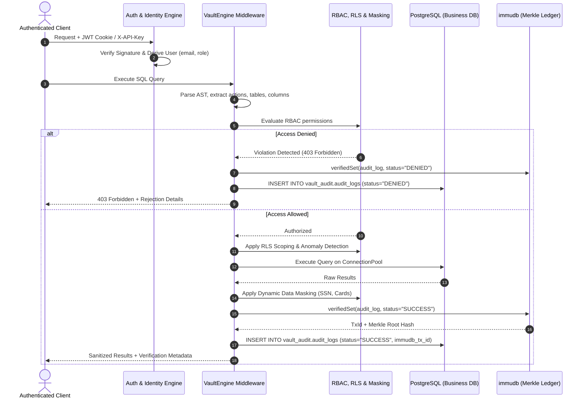

# VaultDB: Cryptographically Immutable Database Middleware

VaultDB is an enterprise-grade compliance and database security middleware connecting application clients to PostgreSQL and immudb. It provides server-derived authentication, zero-trust role-based access control (RBAC), row-level security (RLS), dynamic data masking, real-time anomaly detection, and dual-layer tamper-evident audit logging backed by cryptographic Merkle tree proofs (satisfying GDPR Art. 30, HIPAA §164.312, and PCI-DSS 10.2).

---

## 1. System Architecture

```
+---------------------------------------------------------------------------------------------------+
|                                        Client Applications                                        |
|              (Web Management Console, Python SDK, Microservices, Automated Test Suites)           |
+-------------------------------------------------+-------------------------------------------------+
                                                  |
                                                  v
+---------------------------------------------------------------------------------------------------+
|                                         VaultDB Middleware                                        |
|                                                                                                   |
|  [Authentication & Identity]                                                                      |
|    - Salted PBKDF2-HMAC-SHA256 Password Verification                                              |
|    - RFC 7519 Compliant HS256 JWT (HttpOnly Cookie / Bearer Token)                                |
|    - Cryptographic API Key Verification (X-API-Key Header)                                        |
|    - Server-Derived Identity (Zero Client-Side Trust)                                             |
|                                                                                                   |
|  [SQL Security & Parser Engine]                                                                   |
|    - Action Extraction (SELECT, INSERT, UPDATE, DELETE, DDL:DROP, ALTER, TRUNCATE)                |
|    - Multi-Statement & CTE Write Inspection                                                       |
|    - Table & Schema Scope Extractor (Empty-Table Defense)                                         |
|    - Sensitive Column Detector                                                                    |
|                                                                                                   |
|  [Policy & Enforcement Layer]                                                                     |
|    - Role-Based Access Control (Admin, Auditor, Employee, Customer)                               |
|    - Dynamic Data Masking (SSN: ***-**-XXXX, Card Numbers, CVVs)                                  |
|    - Row-Level Security (RLS Query Rewriting Scoping Customer to Personal Rows)                   |
|    - Real-Time Anomaly Detector (Bulk Records >= 1000, Off-Hours Access, Unprivileged PII)        |
|                                                                                                   |
|  [Dual-Storage Audit Orchestrator]                                                                |
|    - Pre-execution attempt logging                                                                |
|    - Synchronized dual-commit (PostgreSQL Relational Mirror + immudb Merkle Tree)                 |
|    - Cross-Verification Engine (Merkle Root Consistency & Field-Level Diff Tracking)               |
+----------------------------------+------------------------------------+---------------------------+
                                   |                                    |
                                   v                                    v
+---------------------------------------------------+  +--------------------------------------------+
|             PostgreSQL Relational Store           |  |          immudb Cryptographic Ledger       |
|                                                   |  |                                            |
| - ConnectionPool (psycopg-pool)                   |  | - Append-Only Merkle Tree Ledger           |
| - Business Data:                                  |  | - Cryptographic verifiedSet / verifiedGet  |
|     app_data.users                                |  | - Zero-Trust Inclusion Proofs              |
|     app_data.accounts                             |  | - SHA-256 State Root Commitments           |
|     app_data.transactions                         |  | - Immutable Audit Trail History            |
|     app_data.compliance_policies                  |  |                                            |
| - Relational Audit Mirror:                        |  |                                            |
|     vault_audit.audit_logs                        |  |                                            |
| - Immutability Triggers:                          |  |                                            |
|     Blocks UPDATE, DELETE, TRUNCATE at DB engine  |  |                                            |
+---------------------------------------------------+  +--------------------------------------------+
```

### Request and Audit Lifecycle



---

## 2. Threat Model

### What VaultDB Protects Against

1. **Unauthenticated Identity Spoofing**:
   - In prototype architectures, query clients declare their own username or role in the payload. VaultDB derives all identity strictly server-side from cryptographically signed HS256 JWTs or salted API keys.
2. **Rogue Database Administrator (DBA) Tampering**:
   - Standard database audit logs can be wiped or modified by anyone with superuser or DBA access. VaultDB employs database-level PL/pgSQL triggers (`prevent_audit_log_tampering`) that reject `UPDATE`, `DELETE`, and `TRUNCATE` operations on `vault_audit.audit_logs`.
   - Furthermore, even if a DBA disables database triggers out-of-band and mutates a relational record, immudb's append-only Merkle tree ledger maintains the cryptographic source of truth. Any discrepancy between PostgreSQL and immudb is immediately flagged as a critical integrity breach with field-by-field diffs.
3. **Multi-Statement SQL Injection & Privilege Escalation**:
   - Adversarial inputs attempting stacked queries (e.g., `SELECT 1; DROP TABLE app_data.transactions;`), CTE write vectors (`WITH x AS (DELETE ...) SELECT 1;`), `COPY PROGRAM`, or `SET ROLE` are intercepted and blocked before execution.
4. **Unauthorized PII Exfiltration**:
   - Sensitive fields such as Social Security Numbers, credit card numbers, and security codes are automatically masked (`***-**-XXXX`) for non-admin/auditor roles.
5. **Cross-Tenant Data Exposure**:
   - Row-Level Security (RLS) dynamically intercepts customer queries and constrains them to their personal records, preventing customer-to-customer data leaks.
6. **Covert Audit Gap Infiltration**:
   - Audit logs are committed for both successful queries and unauthorized attempts, guaranteeing that reconnaissance scans and attack attempts are permanently recorded.

### What VaultDB Does NOT Protect Against (Residual Risks)

1. **Compromised Operating System Kernel / Physical Host**:
   - If an attacker possesses root access to the physical host running the immudb or PostgreSQL processes, they could inspect memory addresses or terminate running daemons.
2. **immudb Superuser Credential Compromise without External State Anchoring**:
   - If immudb superuser credentials are leaked, an adversary could append bogus entries to the ledger. To mitigate this in strict regulated environments, immudb root hashes should be anchored periodically to external public trust services or notary servers.
3. **Application Vulnerabilities Upstream of the Middleware**:
   - VaultDB inspects and governs database interactions. It does not sanitize untrusted inputs rendered elsewhere in external client web frameworks.

---

## 3. Five-Minute Live Demo Script

Use this walkthrough to demonstrate VaultDB's compliance and cryptographic capabilities:

### Step 1: Login as Employee (Unauthorized Mutation Attempt)
1. Open the Web Console at `http://localhost:8000`.
2. Click the **Employee** persona button on the top authentication bar.
3. Click the preset scenario **Balance Manipulation (Violation)**.
4. Click **Run Query**.
5. **Outcome**: The query is blocked with an HTTP 403 Forbidden status. The rejection explanation confirms that employees cannot modify customer balances. The violation is committed to the immutable audit trail.

### Step 2: Login as Customer (Row-Level Security & Masking)
1. Click the **Customer** persona button (`alice@bank.com`).
2. Run the query: `SELECT * FROM app_data.accounts;`
3. **Outcome**:
   - Notice the **RLS Active** badge: The query is automatically rewritten to restrict rows to Alice Smith's personal account.
   - Notice the **Masking Applied** badge: The SSN column is masked (`***-**-1234`), protecting PII.

### Step 3: Login as Auditor & Review Audit Ledger
1. Click the **Auditor** persona button (`compliance.lead@bank.com`).
2. Navigate down to the **Audit Ledger** section.
3. Filter by action, user, or status.
4. Click **Verify Proof** on any log entry.
5. **Outcome**: A green modal displays the immudb Merkle root hash, transaction ID, timestamp, and a verification confirmation indicating zero cryptographic discrepancies.

### Step 4: The Live Tamper Demonstration
1. In the Audit Ledger toolbar, click the button labeled **Simulate DB Tampering**.
2. A superuser background transaction disables PostgreSQL triggers, modifies an audit record's `query_text` in PostgreSQL to simulate a rogue DBA altering records, and re-enables the trigger.
3. Locate the row with the amber/red highlight or click **Verify Proof** on that row.
4. **Outcome**: The modal displays a prominent RED alert:
   ```
   CRITICAL INTEGRITY BREACH: DATABASE TAMPERING DETECTED
   Field: query_text
   PostgreSQL Mirror: SELECT * FROM simulated_tamper_attempt;
   immudb Ledger Truth: SELECT * FROM app_data.accounts WHERE ...
   ```
5. Click **Restore Untampered State** inside the modal.
6. VaultDB reads the immutable cryptographic record from immudb, overwrites the corrupted PostgreSQL row, and restores integrity.
7. Click **Verify Proof** again: The row is verified 100% INTACT.

### Step 5: Export Compliance Audit Report
1. In the Audit Ledger toolbar, click **Export PDF**.
2. Download and inspect the PDF compliance report containing the cryptographic signatures, transaction heights, and session details suitable for regulatory review.

---

## 4. Quickstart Guide

### Option A: Turnkey Docker Deployment (Recommended)

Ensure Docker and Docker Compose are installed:

```bash
# Build and launch PostgreSQL, immudb, and VaultDB
docker compose up --build
```

The services will initialize schemas, seed users, apply triggers, and start:
- Web Dashboard: `http://localhost:8000`

### Option B: Local Setup (PowerShell / Windows)

#### Prerequisites
- Python 3.11 or 3.12
- PostgreSQL 16+ running on `localhost:5432`
- immudb standalone server (`bin/immudb.exe`)

#### 1. Activate Environment and Install Dependencies
```powershell
.\venv\Scripts\Activate.ps1
pip install -r requirements.txt
```

#### 2. Initialize PostgreSQL and Apply Migrations
```powershell
python scripts/init_databases.py
```

#### 3. Start immudb and Web Server
```powershell
# Launch immudb daemon
.\bin\immudb.exe --dir data/immudb --pgsql-server=true --pgsql-server-port=5433 --port=3322

# In a separate terminal, launch the FastAPI server
python server.py
```

---

## 5. Automated Test Suite

VaultDB includes 135 automated unit, integration, and security tests covering RBAC enforcement, cryptographic proofs, auth lifecycles, and 100+ SQL attack vectors:

```powershell
.\venv\Scripts\pytest.exe -v
```

### Test Coverage Highlights
- **100+ Adversarial SQL Attack Vectors**: Multi-statement injections, CTE writes, `COPY PROGRAM`, `SET ROLE`, `ALTER TABLE`, and out-of-band schema drops.
- **PostgreSQL Immutability Triggers**: Verification that `UPDATE`, `DELETE`, and `TRUNCATE` operations on `vault_audit.audit_logs` are rejected at the database engine level.
- **Authentication Lifecycle**: Salted PBKDF2 hashing verification, RFC 7519 HS256 JWT encoding/decoding, expiration handling, and API key authentication.
- **immudb Operations**: Cryptographic inclusion proofs, transaction state verification, and tamper detection.
- **Dynamic Masking & RLS**: Regex PII redaction and customer row scoping.
- **Anomaly Detection**: Evaluation of bulk thresholds (>= 1,000 rows), off-hours windows, and unprivileged access.

---

## 6. Pre-Seeded Demo Credentials

| Role | Email | Password | API Key |
| :--- | :--- | :--- | :--- |
| **Admin** | `admin@bank.com` | `AdminPass123!` | `vlt_key_admin_9a8b7c6d5e4f3a2b` |
| **Auditor** | `compliance.lead@bank.com` | `AuditorPass123!` | `vlt_key_auditor_5d6e7f8a9b0c1d2e` |
| **Employee** | `john@bank.com` | `EmployeePass123!` | `vlt_key_employee_1a2b3c4d5e6f7a8b` |
| **Customer** | `alice@bank.com` | `CustomerPass123!` | `vlt_key_customer_4d5e6f7a8b9c0d1e` |

---

## 7. Python SDK Usage

```python
import vaultdb

# 1. Connect using authenticated credentials (derives identity server-side)
conn = vaultdb.connect(
    user="alice@bank.com",
    password="CustomerPass123!"
)

# 2. Execute query (automatically scoped via RLS and masked for PII)
results = conn.execute("SELECT * FROM app_data.accounts;")
print("Accounts:", results)

# 3. Retrieve cryptographic audit logs
logs = conn.get_audit_logs(limit=5)
print("Latest Log:", logs[0])

# 4. Verify cryptographic Merkle proof against immudb
proof = conn.verify_audit_log(log_id=logs[0]["log_id"])
print("Cryptographically Verified:", proof["verified"])

conn.close()
```