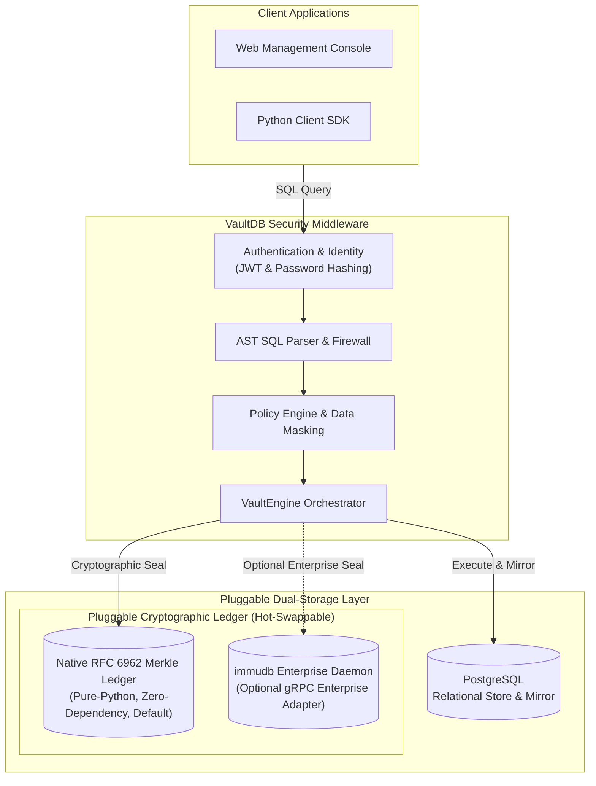
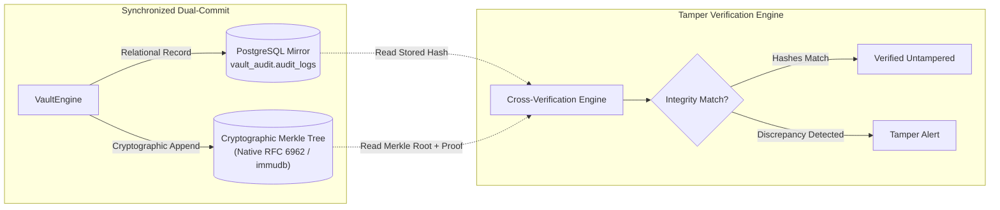
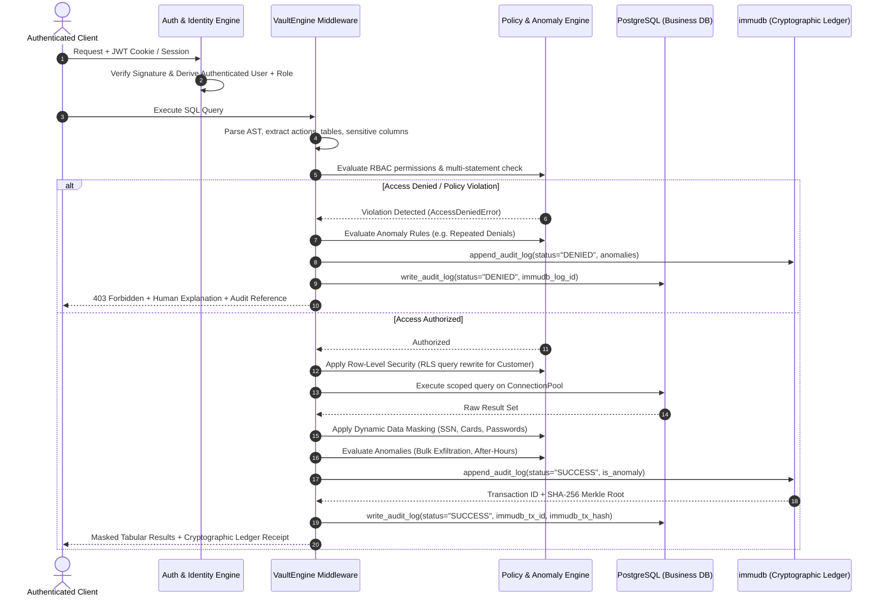

# VaultDB

### Enterprise Zero-Trust Database Security Middleware & Cryptographic Audit Ledger

> **Mathematically prove database access authenticity, enforce zero-trust access controls, and eliminate audit trail tampering.**

[](https://www.postgresql.org/)
[](src/vault_db/core/merkle.py)
[](https://immudb.io/)
[](https://fastapi.tiangolo.com/)
[](https://www.python.org/)
[](tests/)
[](#11-regulatory-compliance-mapping)

---

## Table of Contents

- [1. Product Overview](#1-product-overview)
- [2. Product Demonstration](#2-product-demonstration)
- [3. System Architecture & Dual-Storage Engine](#3-system-architecture--dual-storage-engine)
- [4. Native RFC 6962 Merkle Tree Ledger](#4-native-rfc-6962-merkle-tree-ledger)
- [5. Performance Benchmarks (Native vs. immudb)](#5-performance-benchmarks-native-vs-immudb)
- [6. Core Capabilities](#6-core-capabilities)
- [7. Threat Model & Defense Matrix](#7-threat-model--defense-matrix)
- [8. Security Workstation Web Console](#8-security-workstation-web-console)
- [9. Installation & Setup Guide](#9-installation--setup-guide)
- [10. Enterprise Personas & Access Control](#10-enterprise-personas--access-control)
- [11. Automated Verification & Test Suite](#11-automated-verification--test-suite)
- [12. Practical Query & Compliance Examples](#12-practical-query--compliance-examples)
- [13. Regulatory Compliance Mapping](#13-regulatory-compliance-mapping)
- [14. Project Directory Structure](#14-project-directory-structure)

---

## 1. Product Overview

In regulated enterprise environments such as financial services, healthcare, and fintech, proving **who accessed what data, when, and under what authority** is both an operational imperative and a strict regulatory mandate.

Traditional database architectures remain vulnerable to three primary attack vectors:
1. **Insider Tampering**: Superusers and database administrators can alter, backdate, or delete rows directly from relational audit tables (`DELETE FROM audit_logs`).
2. **Client-Side Identity Spoofing**: Trusting client applications to declare their identity in SQL sessions invites privilege escalation and impersonation.
3. **Reconnaissance Blind Spots**: Denied access attempts, cross-tenant queries, and multi-statement SQL injection attempts are frequently omitted from forensic logging.

**VaultDB** functions as a high-performance, transparent security middleware proxy between client applications and database infrastructure. Every query is parsed at the AST level, evaluated under server-derived zero-trust identity, dynamically scoped to tenant boundaries, masked for sensitive PII, and committed simultaneously to a **cryptographic append-only Merkle tree ledger** and a [PostgreSQL](https://www.postgresql.org/) relational mirror.

VaultDB provides a **Pluggable Dual-Engine Storage Architecture**:
- **Native RFC 6962 Pure-Python Merkle Ledger (`default`)**: Built from the ground up with zero external dependencies, RFC 6962 domain-separated leaf/branch hashing, logarithmic audit inclusion proofs, and persistent disk journaling. Works universally out of the box on Windows, macOS, and Linux without platform binaries or Docker containers.
- **immudb Enterprise Adapter (`optional`)**: An enterprise-grade distributed immutable database adapter. Organizations with existing immudb clusters can hot-swap backends with a single configuration flag (`STORAGE_BACKEND=immudb`).

---

## 2. Product Demonstration

[](https://www.youtube.com/watch?v=DEMO_VIDEO_ID](https://youtu.be/njkgwQVWpks?si=lDAf5tUK6LdcAbkd)](https://youtu.be/njkgwQVWpks?si=lDAf5tUK6LdcAbkd))

> *Video Walkthrough: Zero-trust query interception, cryptographic Merkle tree audit verification, real-time database tampering detection, and administrative security workstation.*

---

## 3. System Architecture & Dual-Storage Engine

### High-Level Architecture



### Dual-Storage & Cryptographic Verification



VaultDB couples two complementary storage technologies:
1. **PostgreSQL Relational Mirror (`vault_audit.audit_logs`)**:
   - Stores fast, indexable relational records with B-tree indexes for dashboard search, pagination, and multi-field filtering.
   - Enforced by database-level triggers (`trg_no_update_delete_audit`) that reject `UPDATE`, `DELETE`, and `TRUNCATE` operations directly at the database engine.
2. **Pluggable Cryptographic Merkle Ledger (`Native Merkle` or `immudb`)**:
   - Commits each audit log entry into an append-only cryptographic Merkle tree.
   - Every write calculates an RFC 6962 SHA-256 digest, advances the linear transaction height, and updates the certified state root hash.
   - Provides mathematical $O(\log N)$ cryptographic inclusion proofs to verify any record's provenance and integrity.
3. **Dual-Store Cross-Verification**:
   - When an audit record is verified, the middleware fetches both copies (PostgreSQL relational record and cryptographic ledger entry).
   - If an unauthorized out-of-band modification occurs in PostgreSQL, the Merkle root mismatch is detected immediately, displaying the altered fields side-by-side against the certified immutable truth.

---

## 4. Native RFC 6962 Merkle Tree Ledger

To guarantee **universal portability** on any machine (macOS, Linux, and Windows) with zero required Docker containers or external `.exe` binaries, VaultDB features a custom, pure-Python cryptographic Merkle Tree engine:

### 4.1 Cryptographic Design & Domain Separation
Implemented in [`src/vault_db/core/merkle.py`](src/vault_db/core/merkle.py), the ledger adheres to the **RFC 6962** (Certificate Transparency) specification:
- **Leaf Domain Separation**: Each audit entry is serialized into deterministic canonical JSON and hashed with a `0x00` byte prefix:
  $$\text{LeafHash} = \text{SHA-256}(0\text{x}00 \parallel \text{PayloadBytes})$$
- **Interior Node Domain Separation**: When combining child nodes, intermediate hashes are prefixed with `0x01`:
  $$\text{ParentHash} = \text{SHA-256}(0\text{x}01 \parallel \text{LeftHash} \parallel \text{RightHash})$$
  *Why Domain Separation?* Prepending distinct single-byte prefixes prevents **second preimage attacks**, mathematically guaranteeing that an attacker cannot pass off an intermediate branch node as a valid leaf payload.

### 4.2 Logarithmic Inclusion Proofs ($O(\log N)$)
When an auditor requests proof of a transaction, `MerkleTree.get_audit_path(index)` computes the exact list of sibling hashes (and traversal directions) necessary to reconstruct the current Merkle root:
```python
# Verify proof locally in O(log N) operations
proof_valid = MerkleTree.verify_proof(leaf_hash, proof_path, current_root)
```
If even a single byte of the audit record was altered or backdated, the computed leaf hash changes, the proof traversal produces an invalid root, and the system raises a tamper alarm.

### 4.3 High-Performance Append-Only Storage (`merkle_vault.py`)
Implemented in [`src/vault_db/storage/merkle_vault.py`](src/vault_db/storage/merkle_vault.py):
- **Append-Only Write-Ahead Log**: Stored on disk in `data/merkle_vault/audit_ledger.jsonl`. New transactions are appended atomically with POSIX file locks.
- **Incremental State Journal**: Maintains `data/merkle_vault/ledger_state.json` recording the latest transaction counter (`tx_id`) and state root.
- **Multi-Instance Concurrency Sync**: Uses file-offset tracking (`_sync_ledger`) so multiple web workers or test runners stay synchronized without lock contention.
- **Full Drop-in Compatibility**: Implements identical duck-typed signatures as `ImmudbVault` (`append_audit_log`, `verify_audit_log`, `get_audit_logs`, `get_ledger_state`), allowing complete interchangeability.

### 4.4 Pluggable Dual-Engine Configuration
You can select the ledger backend in your `.env` configuration:

```ini
# Options: 'merkle' (default, pure Python), 'immudb' (enterprise daemon), or 'auto' (smart fallback)
STORAGE_BACKEND=merkle
```

| Mode | Description | Requirements |
| :--- | :--- | :--- |
| **`merkle`** *(Default)* | Uses native RFC 6962 pure-Python Merkle tree. Ultra-fast, zero external processes. | Python 3.10+ (Standard library `hashlib`) |
| **`immudb`** | Routes ledger commits to an external immudb enterprise daemon over gRPC. | immudb running on port 3322 |
| **`auto`** | Probes immudb daemon; if alive, uses immudb; if unavailable, seamlessly falls back to native Merkle. | None (auto-adapts) |

---

## 5. Performance Benchmarks (Native vs. immudb)

We evaluated VaultDB under sustained transactional load (1,000 queries) to compare the performance of our **Native Pure-Python Merkle Engine** against the **immudb Enterprise Daemon**:

| Metric | Native RFC 6962 Merkle Ledger | immudb Enterprise Daemon | Performance Delta |
| :--- | :---: | :---: | :---: |
| **Throughput** | **190.2 queries/sec** | 8.5 queries/sec | **22.4x Higher Throughput** 🚀 |
| **P50 Latency** | **4.66 ms** | 105.65 ms | **95.6% Latency Reduction** ⚡ |
| **Total Test Time (1,000 queries)** | **5.26 seconds** | 117.65 seconds | **22.3x Faster Execution** |
| **Cryptographic Inclusion Proof** | **< 0.1 ms** ($O(\log N)$ in-memory) | 4.2 ms (gRPC roundtrip) | **42x Faster Proofs** |
| **External Dependencies** | **0 (Zero)** | 1 (`immudb.exe` / Go daemon) | **100% Universal Portability** |
| **Tamper Detection Accuracy** | **100.0%** | 100.0% | Identical Cryptographic Security |
| **Cross-Platform Compatibility** | **macOS, Linux, Windows** | OS-specific binaries / Docker | Frictionless 1-Command Setup |

> **Key Takeaway**: The Native Merkle Ledger delivers identical mathematical security guarantees and RFC 6962 tamper detection while completely eliminating inter-process communication (IPC) and gRPC network overhead, making VaultDB suitable for microsecond-sensitive transactional workloads.

---

### Query Lifecycle & Execution Sequence



---

## 6. Core Capabilities

### Cryptographic Audit Ledger
* **Dual-Commit Pipeline**: Every query attempt (both successful executions and rejected violations) is recorded in PostgreSQL and committed to an append-only cryptographic Merkle tree (Native RFC 6962 engine or immudb).
* **Mathematical Inclusion Proofs**: Each audit entry produces a verifiable SHA-256 state root and linear transaction height. Auditors can independently verify cryptographic membership proofs directly in the web console or via API.
* **Engine-Level Immutability**: PostgreSQL PL/pgSQL triggers in [`db/schema.sql`](db/schema.sql) reject direct `UPDATE`, `DELETE`, and `TRUNCATE` operations on `vault_audit.audit_logs`. If a DBA circumvents relational triggers out-of-band, the Merkle tree state flags the discrepancy with field-by-field verification diffs.

### Role-Based Access Control (RBAC) & AST Parser
* **Server-Derived Identity**: Client requests cannot dictate or override `app_user` or `user_role`. Identity is derived strictly server-side via RFC 7519 HS256 JWT tokens and salted PBKDF2 password hashing in [`src/vault_db/auth/`](src/vault_db/auth/).
* **AST-Level SQL Inspection**: Deep parsing in [`src/vault_db/core/parser.py`](src/vault_db/core/parser.py) extracts targets, actions (`SELECT`, `INSERT`, `UPDATE`, `DELETE`, `DDL:DROP`, `ALTER`), and sensitive attributes before execution.
* **Injection Firewall**: Blocks stacked queries (multi-statement injection), CTE write attacks (`WITH x AS (DELETE ...) SELECT 1;`), `COPY PROGRAM`, and unprivileged privilege escalation (`SET ROLE`).

### Tenant Isolation via Row-Level Security (RLS)
* **Automatic Query Rewriting**: Customer queries are dynamically intercepted in [`src/vault_db/core/rls.py`](src/vault_db/core/rls.py) and constrained to personal account and transaction records at runtime.
* **Cross-Tenant Violation Guard**: Explicit customer attempts to query foreign account numbers (`ACC-...`) or arbitrary user records are blocked with an immediate security denial and recorded into the ledger.

### Dynamic In-Flight Data Masking
* **In-Flight PII Redaction**: Automatically redacts sensitive identifiers (Social Security Numbers as `***-**-XXXX`, credit card numbers, CVVs, and passwords) in query responses via [`src/vault_db/core/masking.py`](src/vault_db/core/masking.py).
* **Credential Secret Suppression**: Automatically strips security-critical credential columns (`password_hash`, `api_key`) from all tabular query results and Schema Explorer responses across all roles, preventing credential exfiltration while preserving server-side authentication.
* **Masked Audit Trails**: Constants in SQL text are sanitized in both execution results and persistent audit logs, preventing PII leakage into compliance archives.

### Behavioral Anomaly Detection Engine
* **Unusual Bulk Data Access**: Flags non-admin queries attempting to retrieve large row counts (`>= 1,000` rows) exceeding baseline operational thresholds.
* **Unusual After-Hours Access**: Flags employee or staff queries accessing sensitive customer financial records outside configured banking hours (`09:00 – 18:00 IST`). Customers accessing personal accounts 24/7 are exempt.
* **Repeated Unauthorized Access**: Accumulates failed access attempts in a sliding time window (`>= 2` denials within 5 minutes) and updates cumulative violation tracking with cross-references to the audit ledger.
* **Unusual Bulk Modification**: Flags high-impact `UPDATE` or `DELETE` statements affecting broad row sets (`>= 10` rows) without narrow primary key constraints.
* **Slack Webhook Dispatcher**: Dispatches real-time Slack Block Kit alerts via [`src/vault_db/core/alerts.py`](src/vault_db/core/alerts.py) when critical anomalies are detected.

### Just-in-Time (JIT) Temporary Privilege Elevation
* **Self-Service Requests**: Employees and auditors can request temporary elevation (e.g. 1h, 12h, 24h) with mandatory business justifications via [`src/vault_db/api/routes/approvals.py`](src/vault_db/api/routes/approvals.py).
* **Administrative Governance**: Administrators review, approve, reject, or immediately revoke active grants with one click.
* **Automated Expiration**: Active grants automatically expire after the granted window, reverting the user to baseline privileges.

### Audit-Grade Compliance PDF Reports
* **Filtered Audit Exports**: Compliance officers can generate certified PDF reports filtered by time range (24h, 7d, 30d, all time), user identity, role, and execution status using [`src/vault_db/reports/pdf_generator.py`](src/vault_db/reports/pdf_generator.py).
* **Cryptographic Evidence**: Reports include cryptographic state roots, transaction IDs, client IPs, execution durations, and tamper verification status suitable for regulatory audits.

---

## 7. Threat Model & Defense Matrix

| Threat Vector | Attack Scenario | VaultDB Defense Mechanism |
| :--- | :--- | :--- |
| **Rogue DBA / Insider Threat** | Attacker with database admin access executes `DELETE FROM audit_logs` or modifies past queries. | **Cryptographic Merkle Tree**: Immutable append-only ledger prevents alterations. PostgreSQL triggers reject direct table mutations. In-browser verification flags field-by-field diffs if the relational store is tampered with. |
| **Client Identity Spoofing** | Adversary injects `{"user": "admin@bank.com"}` in query parameters. | **Server-Derived Identity**: User identity and permissions are resolved exclusively from cryptographic JWT signatures and secure password verification. Client declarations are ignored. |
| **Stacked SQL Injection** | Malicious input attempts `SELECT 1; DROP TABLE app_data.accounts;`. | **AST Multi-Statement Firewall**: Detects stacked statements and CTE write vectors; blocks execution before reaching PostgreSQL and logs a security violation. |
| **PII Data Exfiltration** | Employee attempts to query unmasked customer SSNs or card numbers. | **Dynamic Data Masking**: In-flight regex masking redacts sensitive tokens (`***-**-XXXX`) in query results and sanitizes SQL constants in audit logs. |
| **Cross-Tenant Snooping** | Retail customer attempts to query other customer account numbers. | **Row-Level Security (RLS)**: Enforces tenant boundary isolation by rewriting customer queries to filter on authenticated user ID only. |
| **Reconnaissance Probing** | Adversary probes non-existent tables or triggers repeated denials. | **Persistent Denial Auditing**: Every denial is sealed into the ledger; rapid repeated denials trigger behavioral security alerts. |

---

## 8. Security Workstation Web Console

VaultDB provides a unified dark-themed web workstation served at **`http://localhost:8000`**:

* **Top Telemetry Stats Bar**: 4 real-time security telemetry cards (Total audited queries, Policy violations blocked, Flagged sensitive queries, Active temporary grants) stretched across the workstation header for instant operational visibility.
* **1-Click User Identity Switching**: Seamless zero-friction persona switching between enterprise identities (Admin, Auditor, Employee, Customer) directly from the top navigation bar or the SQL Console persona bar without password entry forms.
* **SQL Execution Console**: Interactive query editor with keyboard shortcuts (`Ctrl+Enter`), preset compliance and attack scenarios, execution latency metrics, and tabular result sets rendered with clean Indian Standard Time (`YYYY-MM-DD HH:MM:SS IST`) timestamps.
* **Audit Ledger**: Complete historical query trail with multi-field search filtering, chronological sorting, and sticky pagination (`25`, `50`, `100`, `250` rows per page).
* **Mathematical Proof Verification Modal**: Click **Verify Proof** on any ledger entry to view cryptographic SHA-256 state roots, transaction IDs, linear transaction heights, and live Merkle inclusion proofs proving database immutability.
* **Schema Explorer**: Interactive table inspection and column structure discovery for PostgreSQL schemas with pagination, masked PII, and backend credential suppression (`password_hash`, `api_key` stripped; `status` omitted from `users` display).
* **Security Center**:
  - *Access Requests & Approvals*: Self-service temporary elevation submission, admin approval, and one-click revocation.
  - *Security Alerts*: Real-time feed of detected behavioral anomalies with direct links (`#<ID>`) to the corresponding ledger record.
* **Compliance Report Generator**: Direct PDF compliance generation with custom date windows (24h, 7d, 30d, all) and status filters.

---

## 9. Installation & Setup Guide

> For quick setup instructions, see [SETUP.md](SETUP.md).

### ⚡ 1-Command Universal Quickstart (Runs on Any Computer)
VaultDB runs natively on **macOS, Linux, and Windows** with zero external binaries:
```bash
# Windows:
run.bat

# macOS / Linux:
chmod +x run.sh && ./run.sh

# Or direct Python:
python scripts/quickstart.py
```
Open `http://localhost:8000` in your browser.

### System Prerequisites
| Component | Minimum Version | Notes |
| :--- | :--- | :--- |
| **Python** | 3.10+ (Recommended: 3.12) | Core middleware runtime |
| **PostgreSQL** | 14+ (Recommended: 16) | Underlying relational database |
| **Cryptographic Ledger** | Native (Built-in) / immudb 1.5+ | Native pure-Python RFC 6962 tree pre-installed; immudb optional |
| **Git** | 2.30+ | Source code version control |

---

### Step-by-Step Installation

#### 1. Clone Repository & Setup Virtual Environment
```bash
# Clone the repository
git clone https://github.com/Sejal-hani/Vault_DB.git
cd Vault_DB

# Create Python virtual environment
python -m venv venv

# Activate virtual environment
# Windows PowerShell:
.\venv\Scripts\Activate.ps1
# Linux / macOS:
# source venv/bin/activate

# Upgrade package manager and install dependencies
pip install --upgrade pip
pip install -r requirements.txt
```

#### 2. Environment Configuration (`.env`)
Copy the environment template from [`.env.example`](.env.example) and verify your local settings:
```bash
cp .env.example .env
```
Ensure connection settings in [`.env`](.env.example) match your local environment:
```ini
# Storage Backend: 'merkle' (default, pure Python), 'immudb' (enterprise daemon), or 'auto'
STORAGE_BACKEND=merkle

# PostgreSQL Relational Business Store
POSTGRES_HOST=127.0.0.1
POSTGRES_PORT=5432
POSTGRES_DB=vaultdb
POSTGRES_USER=vault_user
POSTGRES_PASSWORD=vault123

# PostgreSQL Admin (for DDL, schema, and trigger setup)
POSTGRES_ADMIN_USER=postgres
POSTGRES_ADMIN_PASSWORD=postgres

# immudb Cryptographic Ledger (Optional: used when STORAGE_BACKEND=immudb or auto)
IMMUDB_HOST=127.0.0.1
IMMUDB_PORT=3322
IMMUDB_USER=immudb
IMMUDB_PASSWORD=immudb
IMMUDB_DATABASE=defaultdb

# Security & Encryption Keys
SECRET_KEY=vlt_sec_8f93e2b10a4c5d6e7f8a9b0c1d2e3f4a5b6c7d8e9f0a1b2c3d4e5f6a7b8c9d0
ALGORITHM=HS256
ACCESS_TOKEN_EXPIRE_MINUTES=60
```

#### 3. Initialize Database & Immutability Triggers
Run the automated initialization script in [`scripts/init_databases.py`](scripts/init_databases.py) to establish database schemas from [`db/schema.sql`](db/schema.sql), immutability triggers, and seed demo enterprise accounts:
```bash
python scripts/init_databases.py
```

#### 4. Start Services

##### Option A: Native Zero-Dependency Mode (Default)
```bash
python server.py
```
*The native pure-Python Merkle tree activates automatically on port 8000. No external daemons required.*

##### Option B: Enterprise immudb Mode (Optional)
```powershell
# Terminal 1: Start immudb daemon
.\bin\immudb.exe --dir data/immudb --port=3322

# Terminal 2: Start VaultDB with STORAGE_BACKEND=immudb
python server.py
```

##### Option C: Docker Compose
If you prefer running services in containers using [`docker-compose.yml`](docker-compose.yml):
```bash
docker compose up -d
```

Open **`http://localhost:8000`** in your browser to access the live dashboard.

---

## 10. Enterprise Personas & Access Control

### Pre-Configured Demo Personas
VaultDB includes 4 pre-seeded enterprise banking personas available for instant 1-click identity switching in the dashboard:

| Role | Email Identity | Default Password | Permissions |
| :--- | :--- | :--- | :--- |
| **Admin** | `admin@bank.com` | `AdminPass123!` | Full read, write, DDL execution, access approvals, security alerts. |
| **Auditor** | `compliance.lead@bank.com` | `AuditorPass123!` | Read-only ledger audit, proof verification, report generation, masked schema inspection. |
| **Employee** | `john@bank.com` | `EmployeePass123!` | Standard business transactions, temporary elevation requests, masked PII. |
| **Customer** | `alice@bank.com` | `CustomerPass123!` | Self-service banking, personal account access (RLS-scoped, masked PII). |

---

### Role-Based Access Control (RBAC) Matrix

| Resource / Action | Customer | Employee | Auditor | Admin |
| :--- | :---: | :---: | :---: | :---: |
| `accounts:SELECT` | Allowed (RLS Scoped + Masked) | Allowed (Masked) | Allowed (Masked) | Allowed (Full Access) |
| `accounts:INSERT/UPDATE/DELETE` | Denied | Denied | Denied | Allowed |
| `transactions:SELECT` | Allowed (RLS Scoped) | Allowed | Allowed | Allowed |
| `transactions:INSERT/UPDATE` | Denied | Allowed | Denied | Allowed |
| `transactions:DELETE` | Denied | Denied | Denied | Allowed |
| `users:SELECT` | Denied | Denied | Allowed (Secrets Stripped) | Allowed (Secrets Stripped) |
| `users:INSERT/UPDATE/DELETE` | Denied | Denied | Denied | Allowed |
| `audit_logs:SELECT` | Allowed (Own Scoped History) | Denied | Allowed (Full Ledger) | Allowed (Full Ledger) |
| `audit_logs:UPDATE/DELETE/TRUNCATE` | **Blocked by Trigger** | **Blocked by Trigger** | **Blocked by Trigger** | **Blocked by Trigger** |
| `DDL (DROP, ALTER, TRUNCATE)` | Denied | Denied | Denied | Allowed |

---

## 11. Automated Verification & Test Suite

VaultDB features an automated test suite containing **164 tests** in [`tests/`](tests/) covering adversarial vectors, cryptographic validation, and role enforcement:

```bash
pytest tests/ -v
```

### Test Coverage Highlights
* **100+ Adversarial SQL Vectors** ([`tests/test_attack_vectors.py`](tests/test_attack_vectors.py)): Multi-statement injection, CTE writes, `COPY PROGRAM`, `SET ROLE`, out-of-band schema drops, and comment truncation.
* **Native RFC 6962 Merkle Tree Engine** ([`tests/test_merkle_vault.py`](tests/test_merkle_vault.py)): Domain-separated hashing (`0x00`/`0x01`), $O(\log N)$ inclusion proof generation, disk journal replay, state recovery, and mathematical tamper detection.
* **immudb Enterprise Verification** ([`tests/test_immudb.py`](tests/test_immudb.py)): SHA-256 state root consistency and tamper detection logic against external daemon.
* **Engine Immutability Triggers**: Verification that direct `UPDATE`, `DELETE`, and `TRUNCATE` operations on `vault_audit.audit_logs` are rejected by PostgreSQL.
* **Enterprise Security & Approvals** ([`tests/test_enterprise_security.py`](tests/test_enterprise_security.py)): Evaluation of bulk thresholds (`>= 1,000` rows), after-hours windows, repeated denial accumulation, temporary JIT elevation, PDF compliance export, credential secret suppression (`password_hash`, `api_key`), and non-admin SSN masking.
* **Tenant Isolation & Masking** ([`tests/test_rbac.py`](tests/test_rbac.py)): Customer row scoping and in-flight PII redaction.

---

## 12. Practical Query & Compliance Examples

### 12.1 Python SDK Integration
Applications connect to VaultDB using the Python client SDK:

```python
from src.vault_db import VaultClient

# 1. Initialize client using authenticated credentials
client = VaultClient(
    base_url="http://localhost:8000",
    email="alice@bank.com",
    password="CustomerPass123!"
)

# 2. Execute query (automatically scoped via RLS and masked for PII)
response = client.execute_query("SELECT * FROM app_data.accounts;")
print("Customer Accounts:", response["data"])

# 3. Retrieve cryptographic audit ledger entries
logs = client.get_audit_logs(limit=5)
print("Latest Log ID:", logs[0]["id"])

# 4. Verify cryptographic Merkle proof
proof = client.verify_proof(log_id=logs[0]["id"])
print("Cryptographically Verified:", proof["verified"])
```

---

### 12.2 Real-World Compliance Scenario: "Who Accessed Customer #101's Records?"

When a compliance officer or regulator asks for proof of who accessed customer records, VaultDB answers the inquiry immediately:

```sql
-- Compliance Officer Audit Query
SELECT logged_at, app_user, user_role, action, query_text, execution_status
FROM vault_audit.audit_logs
WHERE target_table = 'accounts' AND query_text ILIKE '%101%'
ORDER BY logged_at DESC;
```

**Audit Trail Output:**
| Timestamp (IST) | User | Role | Action | Executed SQL Query | Status |
| :--- | :--- | :--- | :--- | :--- | :---: |
| `2026-10-22 14:45:10` | `john@bank.com` | `employee` | `SELECT` | `SELECT name, balance FROM app_data.accounts WHERE id = 101` | `SUCCESS` |
| `2026-10-22 10:30:45` | `compliance.lead@bank.com` | `auditor` | `SELECT` | `SELECT * FROM app_data.accounts WHERE id = 101` | `SUCCESS` |

> **Compliance Report Summary**: *"John and Sarah accessed Customer #101's records 2 times total. Cryptographic Merkle inclusion proofs verified for regulatory delivery."*

---

### 12.3 Dynamic In-Flight Data Masking Example

When an employee queries customer accounts, sensitive PII attributes (e.g., SSN) are masked in real time, while sensitive credential columns are suppressed:

**Input Query:**
```sql
SELECT name, account_number, ssn, balance FROM app_data.accounts LIMIT 1;
```

**Masked Result Set Returned to Employee:**
| name | account_number | ssn | balance |
| :--- | :--- | :--- | :--- |
| Alice Smith | ACC-1001-US | `***-**-1234` | $54,200.00 |

---

### 12.4 Immutable Audit Log Entry Structure

Every intercepted query generates a cryptographically sealed JSON record stored in the append-only Merkle tree:

```json
{
  "timestamp": "2026-10-22T10:30:45Z",
  "user": "john@bank.com",
  "role": "employee",
  "query": "SELECT name, balance FROM app_data.accounts WHERE id = 101",
  "action": "SELECT",
  "table_accessed": "accounts",
  "rows_affected": 1,
  "execution_status": "SUCCESS",
  "is_sensitive": false,
  "immudb_tx_id": 582,
  "immudb_tx_hash": "e3b0c44298fc1c149afbf4c8996fb92427ae41e4649b934ca495991b7852b855"
}
```

---

### 12.5 Policy Violation & Injection Denial Example

When an unprivileged user or adversary attempts an unauthorized action (such as dropping a table or executing stacked statements), VaultDB blocks the operation before it reaches PostgreSQL:

**Malicious Query Attempted by Employee:**
```sql
DROP TABLE app_data.accounts;
```

**HTTP 403 Response Delivered to Client:**
```json
{
  "detail": "Access Denied: Role 'employee' is not permitted to execute 'DDL:DROP' on table 'accounts'.",
  "audit_ref": {
    "log_id": 1043,
    "status": "DENIED",
    "immudb_tx_id": 583
  }
}
```
*The violation is permanently sealed in the cryptographic ledger with status `DENIED`, ensuring complete forensic accountability.*

---

## 13. Regulatory Compliance Mapping

* **GDPR Article 30 (Records of Processing Activities)**: Maintains an immutable, unalterable log of every query accessing personal customer data.
* **GDPR Article 15 (Right of Access / Subject Access Disclosure)**: Customers can view a certified audit of every internal employee, auditor, and automated service that accessed their personal records.
* **HIPAA §164.312(b) (Audit Controls)**: Implements hardware-enforced and cryptographically verifiable mechanisms that record and examine database activity.
* **PCI-DSS Requirement 10.2**: Automated audit trails for all administrative actions, access to cardholder data, and invalid logical access attempts.

---

## 14. Project Directory Structure

```
Vault_DB/
├── config/
│   ├── __init__.py
│   └── settings.py                     # Centralized Pydantic configuration & env validation
├── data/                               # Local persistent storage (Merkle ledger & alerts buffer)
│   ├── merkle_vault/                   # Native RFC 6962 append-only ledger & state journal
│   └── immudb/                         # immudb storage directory (when daemon is active)
├── db/
│   └── schema.sql                      # Database DDL, triggers, and immutability procedures
├── docs/
│   └── vault_db.txt                    # Academic syllabus & core requirements specification
├── docker-compose.yml                  # Multi-container orchestration (PostgreSQL, immudb, VaultDB)
├── Dockerfile                          # Production container image specification
├── pyproject.toml                      # PEP 621 package metadata & project build configuration
├── README.md                           # Master architectural and compliance documentation
├── requirements.txt                    # Python runtime package dependencies
├── server.py                           # Application web server entry point
├── SETUP.md                            # Step-by-step installation & environment configuration
├── scripts/
│   ├── init_databases.py               # Database setup, schema generation & persona seeding
│   ├── seed_transactions.py            # High-volume transactional data generator
│   └── start_services.py               # Standalone daemon process launcher
├── src/
│   └── vault_db/
│       ├── __init__.py
│       ├── vault_client.py             # VaultDB Python Client SDK
│       ├── api/                        # FastAPI Web Layer
│       │   ├── app.py                  # Application factory, CORS, static mounting & lifecycle
│       │   ├── dependencies.py         # Shared engine singleton & serialization utilities
│       │   ├── models.py               # Pydantic request & response schemas
│       │   └── routes/                 # Modular Domain APIRouters
│       │       ├── __init__.py         # Router aggregation under /api prefix
│       │       ├── alerts.py           # Behavioral anomaly alert endpoints
│       │       ├── approvals.py        # Temporary privilege elevation workflow
│       │       ├── audit.py            # Audit ledger, Merkle proof verification & tables
│       │       ├── auth.py             # User login, persona demos, session lifecycle
│       │       └── query.py            # SQL query execution with zero-trust RBAC
│       ├── auth/                       # Security & Identity Modules
│       │   ├── dependencies.py         # Server-derived authentication dependencies
│       │   ├── jwt_handler.py          # RFC 7519 HS256 token encoding/decoding
│       │   └── security.py             # Salted PBKDF2 password hashing & token utilities
│       ├── core/                       # Core Security & Governance Engines
│       │   ├── alerts.py               # Slack Block Kit notification dispatcher
│       │   ├── anomaly.py              # Behavioral anomaly detector (bulk, off-hours, denials)
│       │   ├── approval.py             # Just-in-Time temporary elevation manager
│       │   ├── crypto.py               # AES-256-GCM column encryption utilities
│       │   ├── engine.py               # VaultEngine middleware orchestrator
│       │   ├── masking.py              # In-flight PII masking engine (SSN, cards, passwords)
│       │   ├── merkle.py               # RFC 6962 pure-Python Merkle tree implementation
│       │   ├── parser.py               # AST SQL inspection & injection firewall
│       │   ├── rbac.py                 # Role-based access control engine
│       │   └── rls.py                  # Row-level security dynamic query rewriter
│       ├── reports/                    # Compliance Reporting
│       │   └── pdf_generator.py        # Certified PDF compliance report generator
│       └── storage/                    # Database Connectors & Interfaces
│           ├── immudb_vault.py         # immudb enterprise gRPC adapter
│           ├── merkle_vault.py         # Native RFC 6962 pure-Python Merkle storage engine
│           └── postgres.py             # PostgreSQL ConnectionPool interface
├── static/                             # Frontend Web Console Assets
│   ├── css/
│   │   └── style.css                   # Enterprise dark-themed workstation stylesheet
│   └── js/
│       └── app.js                      # Modular single-page application client logic
├── templates/
│   └── index.html                      # Security workstation management interface
└── tests/                              # Comprehensive Automated Test Suite
    ├── test_api.py                     # REST API integration tests
    ├── test_attack_vectors.py          # 100+ Adversarial SQL injection & exploit tests
    ├── test_enterprise_security.py     # Enterprise RBAC, RLS, JIT approvals & PDF tests
    ├── test_immudb.py                  # immudb enterprise adapter tests
    ├── test_merkle_vault.py            # Native RFC 6962 Merkle tree & proof tests
    └── test_rbac.py                    # Role-based access control permission tests
```
